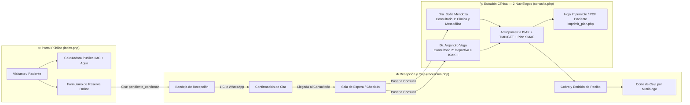
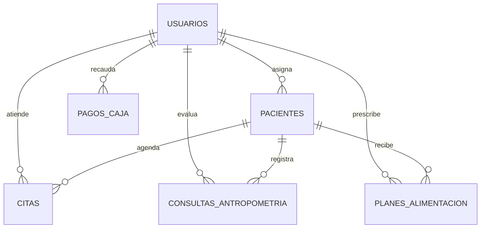

# nutricare-pro-cpanel
# 🥗 NutriCare Pro — Plataforma de Administración de Consultorio de Nutrición (PHP 8 + MySQL para cPanel)

**NutriCare Pro** es una plataforma integral de gestión clínica, recepcional, financiera y promocional diseñada para un **consultorio de nutrición con 2 especialistas titulares** y **personal de recepción**. Construida en **PHP 8 (PDO) + MySQL/MariaDB + CSS3/JS**, está optimizada para desplegarse directamente en cualquier servidor compartido con **cPanel** (`public_html`, `MySQL Database Wizard`, `phpMyAdmin` y despliegue continuo vía `Git™ Version Control`).

## 📸 Vista Previa del Diseño e Interfaz (Capturas de Módulos)

### 1. Página Principal Promocional y Captación de Pacientes (`index.php`)
Presenta la propuesta de valor de la clínica, el perfil profesional y tarifas de los **2 especialistas titulares** (*Dra. Sofía Mendoza — Nutrición Clínica y Metabólica* y *Dr. Alejandro Vega — Nutrición Deportiva y Cineantropometría ISAK II*), una **calculadora interactiva gratuita de IMC e hidratación** (*lead magnet*) y un **formulario de agendado en línea** con validación automática de horarios ocupados.

### 2. Módulo de Recepción, Sala de Espera en Vivo y Corte de Caja (`recepcion.php`)
Permite al área de recepción gestionar el flujo de citas en tiempo real (`Por Confirmar Web` → `Confirmada` → `En Sala de Espera` con registro de hora de llegada *Check-in* → `En Consulta` → `Finalizada`), filtrar la agenda por especialista, enviar confirmaciones pre-consulta con un clic vía **WhatsApp** y llevar el **corte de caja diario** desglosado por nutriólogo y método de pago (*Efectivo, Tarjeta, Transferencia SPEI*).

### 3. Estación Clínica, Antropometría ISAK y Cálculo SMAE (`consulta.php`)
Estación de trabajo médica para los 2 nutriólogos con expediente clínico completo, evaluación antropométrica avanzada (bioimpedancia + perímetros + **4 pliegues cutáneos ISAK**), cálculo simultáneo de gasto energético (**Mifflin-St Jeor**, **Harris-Benedict**, **Katch-McArdle**), distribución de equivalentes **SMAE**, gráficas de evolución y seguimiento de biomarcadores de laboratorio.

## 🏗️ Arquitectura y Flujo Operativo del Consultorio

## 🧮 Herramientas Clínicas y Fórmulas Nutricionales Integradas

| Herramienta Clínica | Ecuación / Algoritmo Implementado | Aplicación en Consulta |
| :--- | :--- | :--- |
| **Gasto Energético Basal (TMB)** | **Mifflin-St Jeor**: Hombres: `(10×Peso) + (6.25×Talla) - (5×Edad) + 5` · Mujeres: `(10×Peso) + (6.25×Talla) - (5×Edad) - 161` | Estándar clínico actual para pacientes con normopeso, sobrepeso u obesidad. |
| **Fórmula Clásica y Deportiva** | **Harris-Benedict** y **Katch-McArdle** (`TMB = 370 + 21.6 × Masa Magra kg`) | Precisión en pacientes deportistas o con alta masa muscular (Dr. Alejandro Vega). |
| **Gasto Energético Total (GET)** | `GET = (TMB × FAF) + (TMB × 0.10 ETA)` | Incluye Factor de Actividad Física (`1.20` a `1.90`) y Efecto Termogénico de los Alimentos (`10%`). |
| **Plicometría ISAK (4 Pliegues)** | **Durnin & Womersley + Ecuación de Siri**: Suma de pliegues Tricipital, Bicipital, Subescapular y Suprailíaco (`% Grasa = (495 / Densidad) - 450`) | Evaluación objetiva de adiposidad subcutánea y evolución de recomposición corporal. |
| **Riesgo Cardiometabólico** | **IMC** (`Peso / Talla²`), **ICC** (`Cintura / Cadera`) e **ICT** (`Cintura / Talla`, alerta si `>= 0.50`) | Estratificación automática de riesgo metabólico y resistencia a la insulina. |
| **Sistema de Equivalentes (SMAE)** | Matriz interactiva por grupo (Verduras, Frutas, Cereales s/g, Leguminosas, AOA, Leche, Grasas s/p y c/p) | Verifica en tiempo real el porcentaje de adecuación calórica y de macronutrientes (`95% - 105%`). |

## 🗄️ Modelo Entidad-Relación de la Base de Datos (`database.sql`)

## 📂 Estructura de Archivos del Repositorio

| Archivo | Rol en la Plataforma |
| :--- | :--- |
| [`database.sql`](database.sql) | Esquema MySQL InnoDB completo con 7 tablas y semillas para los 2 nutriólogos y recepción |
| [`db_connection.php`](db_connection.php) | Conexión PDO MySQL para cPanel, protección CSRF, sesiones y fórmulas nutricionales |
| [`index.php`](index.php) | Landing Page pública promocional, calculadora IMC y reserva de citas en línea |
| [`recepcion.php`](recepcion.php) | Control de sala de espera en tiempo real, recordatorios por WhatsApp y corte de caja diario |
| [`consulta.php`](consulta.php) | Estación clínica, antropometría ISAK (4 pliegues), cálculo TMB/GET y plan SMAE |
| [`imprimir_plan.php`](imprimir_plan.php) | Formato imprimible / PDF del plan de alimentación por tiempos de comida para el paciente |
| [`style.css`](style.css) | Sistema de diseño UI/UX responsivo y reglas de impresión (`@media print`) |
| [`.cpanel.yml`](.cpanel.yml) | Conector de despliegue continuo hacia `public_html/` desde **Git™ Version Control** en cPanel |

## 🚀 Instalación y Despliegue en cPanel

1. **Despliegue Automático con Git™ Version Control**: Abre **Git™ Version Control** en tu cPanel, clona este repositorio y presiona **Deploy HEAD Commit** en la pestaña *Pull or Deploy* para publicar automáticamente los archivos en `public_html/`.
2. 2. **Base de Datos MySQL**: Crea tu base de datos y usuario desde **MySQL® Database Wizard**, importa [`database.sql`](database.sql) en **phpMyAdmin** y configura `DB_NAME`, `DB_USER` y `DB_PASS` en [`db_connection.php`](db_connection.php).
