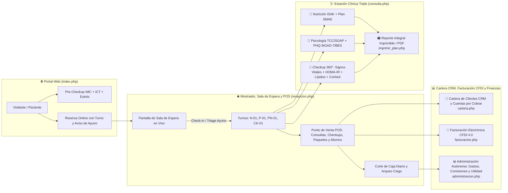

# 🧠🥗🔬 NutriMind & Care Pro — Plataforma Integral para Consultorio de Nutrición, Psicología, Psiconutrición y Checkups 360° (PHP 8 + MySQL/SQLite para cPanel)

**NutriMind & Care Pro** es una plataforma clínica, recepcional, fiscal y financiera de **administración autónoma**, diseñada para operar un centro interdisciplinario de **Nutrición Clínica y Deportiva (ISAK II)**, **Psicología Clínica (TCC)**, **Psiconutrición (TCA y Hambre Emocional)** y **Checkups Médicos Integrales 360°**.

Construida en **PHP 8 (PDO) + MySQL/MariaDB (con soporte automático SQLite local) + CSS3/JS**, está lista tanto para ejecutarse localmente sin configuración adicional como para desplegarse directamente en **cPanel** (`public_html`, `MySQL Database Wizard`, `phpMyAdmin` y `Git™ Version Control`).

---

## 🏗️ Arquitectura Operativa de punta a punta (Administración Autónoma)

---

## 🌟 Módulos Principales del Sistema

### 1. 🌐 Portal Web y Captación con Pre-Checkup (`index.php`)
- **Pre-Checkup Interactivo Gratuito**: Calcula IMC, Índice Cintura-Talla (`ICT` para riesgo cardiometabólico), meta de hidratación y nivel de estrés/ansiedad alimentaria para recomendar el servicio ideal.
- **Directorio de los 4 Especialistas Titulares**:
  - *Dra. Sofía Mendoza* — Nutrición Clínica, Síndrome Metabólico y Checkups Cardiometabólicos.
  - *Dr. Alejandro Vega* — Nutrición Deportiva, Cineantropometría ISAK II y Checkup de Rendimiento.
  - *Mtra. Valeria Rojas* — Psicología Clínica, Terapia Cognitivo-Conductual (TCC), Ansiedad y Depresión.
  - *Dr. Daniel Herrera* — Psiconutrición, Trastornos de la Conducta Alimentaria (TCA) y Psicología Bariátrica.
- **Reserva en Línea Inteligente**: Asigna folio de turno para Sala de Espera (`N-`, `P-`, `PN-`, `CK-`) y detecta automáticamente si el paciente requiere **ayuno de 8 a 10 horas** (en caso de agendar Checkup).

### 2. 🛎️ Mostrador, Sala de Espera en Vivo, Triage y Caja POS (`recepcion.php`)
- **Pantalla de Sala de Espera en Tiempo Real**: Muestra turnos activos (`En Sala`, `En Consultorio`, `Pasar a Caja`), consultorio asignado, hora de llegada (*Check-in*) e indicador de verificación de ayuno para Checkups.
- **Flujo de Estados con 1 Clic**: `Por Confirmar` → `Confirmada` → `En Sala` → `En Consulta` → `Por Cobrar` → `Finalizada` + recordatorio directo por **WhatsApp**.
- **Punto de Venta (POS) Clínico**:
  - Venta de consultas individuales, **Checkups 360°**, **Paquetes prepagados** y **Abonos a saldo pendiente**.
  - **Redención de sesiones de paquete activo** con descuento automático en las sesiones disponibles del paciente.
  - Cálculo automático de la **comisión del especialista** (`70%` / `75%`) y envío a bandeja de **Facturación CFDI 4.0**.
- **Corte de Caja Diario y Arqueo Ciego**: Compara el efectivo esperado en gaveta (`Fondo Fijo + Efectivo Cobrado - Gastos en Efectivo`) contra el efectivo físico contado.

### 3. 👥 Cartera de Clientes CRM, Paquetes y Cuentas por Cobrar (`cartera.php`)
- **Control de Membresías y Paquetes**: Visualiza cuántas sesiones de Nutrición, Psicología y Checkups tiene disponibles cada paciente.
- **Cuentas por Cobrar y Liquidación Rápida**: Identifica pacientes con saldo pendiente, envía recordatorios de pago por WhatsApp y permite registrar abonos o liquidaciones en un clic.
- **Alertas de Retención Clínica**: Detecta pacientes en riesgo de abandono para seguimiento proactivo.
- **Ficha Fiscal CFDI 4.0 Integrada**: Almacena RFC, Razón Social, Régimen Fiscal SAT, Código Postal y Uso de CFDI (`D01`).

### 4. 🧾 Facturación Electrónica CFDI 4.0 (`facturacion.php`)
- **Bandeja de Recibos POS Pendientes de Facturar**: Carga con un clic cualquier cobro de mostrador que haya solicitado factura.
- **Catálogos SAT CFDI 4.0 Integrados**: Claves de producto/servicio `85121800` (Nutrición y Checkups) y `85121600` (Psicología y Psiconutrición), Unidad `E48`, Uso `D01` (Deducción personal de honorarios médicos, psicológicos y nutricionales).
- **Representación Impresa CFDI 4.0 (PDF)**: Genera comprobante fiscal con Folio Interno, UUID Fiscal, Sello Digital y desglose de impuestos listo para imprimir o guardar en PDF.

### 5. 🩺 Estación Clínica Triple: Nutrición + Psicología + Checkups (`consulta.php`)
- **Pestaña 1 — 🥗 Nutrición, Antropometría ISAK y Plan SMAE**: Peso, talla, IMC, % grasa, % músculo, grasa visceral, cintura, cadera, ICC, ICT, 4 pliegues cutáneos ISAK, gasto energético (`Mifflin-St Jeor`, `Katch-McArdle`, `Harris-Benedict`), diagnóstico PES y prescripción de menú SMAE por tiempos de comida.
- **Pestaña 2 — 🧠 Psicología Clínica y Psiconutrición**: Notas clínicas estructuradas **SOAP**, Examen del Estado Mental (EEM), escalas psicométricas cuantitativas (**PHQ-9 Depresión**, **GAD-7 Ansiedad**, **Escala BES de Atracón / Hambre Emocional**), calidad de sueño, tareas terapéuticas y acuerdos interdisciplinarios con Nutrición.
- **Pestaña 3 — 🔬 Checkup Médico Integral 360°**: Signos vitales (`Presión Arterial`, `FC`, `Temperatura`, `SpO2`), panel de laboratorio (`Glucosa`, `Insulina Basal`, cálculo automático de **Índice HOMA-IR**, `HbA1c`, `Colesterol Total`, `Triglicéridos`, `HDL`, `LDL`, `TSH Tiroides`, `Cortisol Matutino`, `Vitamina D`), semáforo clínico y Score de Salud 360° (`0-100`).

### 6. 📊 Administración Autónoma y Finanzas (`administracion.php`)
- **Estado de Resultados en Vivo**: Ingresos brutos, nómina de comisiones a especialistas, retención neta de la clínica, gastos operativos y flujo de caja.
- **Liquidación de Comisiones por Especialista**: Tabla auditable con el monto exacto a pagar a cada nutriólogo y psicólogo.
- **Registro de Gastos Operativos y Laboratorio**: Control de egresos por renta, reactivos/laboratorio de checkups, insumos, publicidad y servicios.
- **Gestor Autónomo de Catálogo y Tarifas**: Permite dar de alta nuevos Checkups, paquetes o servicios.

---

## 📂 Estructura de Archivos del Repositorio

| Archivo | Rol en la Plataforma |
| :--- | :--- |
| [`database.sql`](database.sql) | Esquema MySQL InnoDB completo con **12 tablas** y semillas de demostración |
| [`db_connection.php`](db_connection.php) | Conexión dual **MySQL (cPanel) + Auto-SQLite Local**, seguridad CSRF, fórmulas clínicas y catálogos SAT |
| [`index.php`](index.php) | Portal público promocional, calculadora Pre-Checkup y agenda en línea con asignación de turno |
| [`recepcion.php`](recepcion.php) | Mostrador, pantalla de Sala de Espera en vivo, triage de Checkups, Caja POS y Corte de Caja diario |
| [`cartera.php`](cartera.php) | Cartera de Clientes CRM, control de paquetes/checkups, cuentas por cobrar y alta fiscal CFDI |
| [`facturacion.php`](facturacion.php) | Módulo de Facturación CFDI 4.0, timbrado de recibos POS y representación impresa PDF |
| [`consulta.php`](consulta.php) | Estación clínica interdisciplinaria: Nutrición ISAK + Psicología TCC/SOAP + Checkups 360° (HOMA-IR) |
| [`administracion.php`](administracion.php) | Administración autónoma: Estado de resultados, comisiones por especialista, gastos y catálogo |
| [`imprimir_plan.php`](imprimir_plan.php) | Reporte clínico integral imprimible/PDF (Checkup 360° + Antropometría + Menú SMAE + Psiconutrición) |
| [`style.css`](style.css) | Sistema de diseño UI/UX clínico responsivo y reglas de impresión (`@media print`) |
| [`.cpanel.yml`](.cpanel.yml) | Conector de despliegue automático hacia `public_html/` desde **Git™ Version Control** en cPanel |
