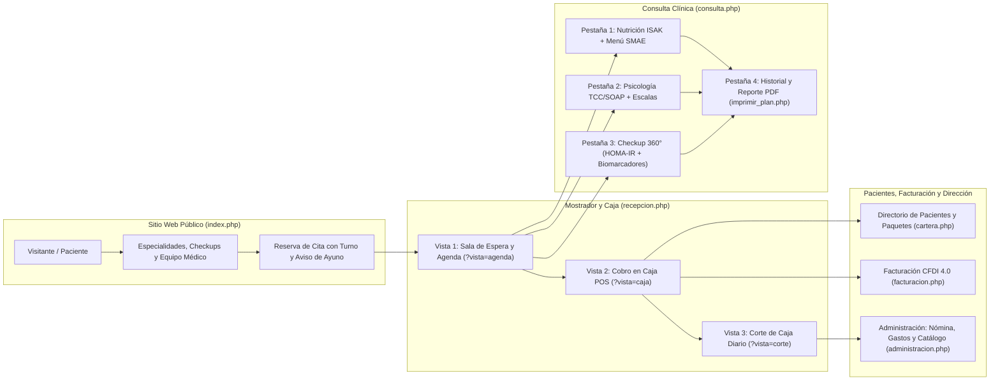
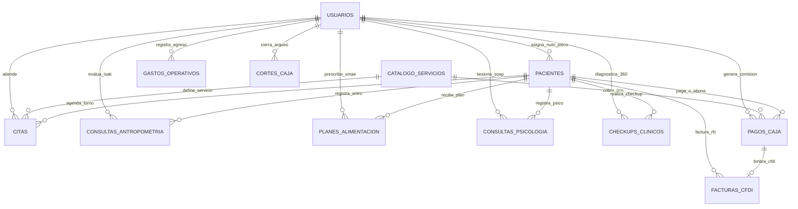

# Clínica NutriMind — Plataforma Integral de Nutrición, Psicología, Psiconutrición y Checkups (PHP 8 + MySQL/SQLite para cPanel)

**Clínica NutriMind (NutriCare Pro)** es una plataforma clínica, recepcional, fiscal y financiera de **administración autónoma**, diseñada para operar un consultorio interdisciplinario de **Nutrición Clínica y Deportiva (ISAK II)**, **Psicología Clínica (TCC)**, **Psiconutrición** y **Checkups Médicos Preventivos 360°**.

Construida en **PHP 8 (PDO) + MySQL/MariaDB (con soporte automático SQLite local)** y un **Sistema de Diseño Editorial Clínico** (`Fraunces` + `DM Sans`, fotografía médica real, navegación separada entre Sitio Web Público y Sistema Clínico con Barra Lateral Izquierda, y pantallas de propósito único sin saturación visual).

---

## Arquitectura UX/UI y Pantallas de Propósito Único

### 1. Sitio Web Público Editorial con Fotografía Real (`index.php`)
Navegación pública independiente (`Especialidades`, `Checkups`, `Especialistas`, `Aranceles`, `Agendar cita` y botón discreto de `Acceso Clínico`). Incluye hero editorial cálido, tarjetas visuales con fotografía de cada área clínica, comparativa clara de Checkups preventivos, retratos reales del equipo médico con cédula profesional y formulario limpio de reserva en línea.


### 2. Mostrador y Caja con Vistas Separadas por Tarea (`recepcion.php`)
Integra la barra lateral izquierda del sistema clínico y divide la operación de recepción en **3 sub-vistas concretas** para evitar saturación:
- **Sala de Espera y Agenda (`?vista=agenda`)**: Flujo de pacientes paso a paso (`Marcar en Sala` → `Pasar a Consultorio` → `Cobrar`) y ventana modal (`+ Nueva Cita`) para registros rápidos.
- **Caja POS (`?vista=caja`)**: Pantalla dedicada exclusivamente al cobro de consultas, paquetes o checkups y emisión de recibos.
- **Corte de Caja (`?vista=corte`)**: Pantalla dedicada exclusivamente al arqueo de efectivo y cierre de turno.


### 3. Consulta Clínica Enfocada por Especialidad (`consulta.php`)
Encabezado compacto del paciente (con fotografía, edad y objetivo clínico) y **4 pestañas independientes** de propósito único:
1. **Nutrición y Menú SMAE (`?tab=nutricion`)**: Antropometría InBody/ISAK y plan alimenticio.
2. **Psicología y Escalas (`?tab=psicologia`)**: Tamizaje PHQ-9, GAD-7, BES y nota clínica SOAP.
3. **Checkup 360° (`?tab=checkup`)**: Signos vitales, panel metabólico y cálculo automático de resistencia a la insulina **HOMA-IR**.
4. **Historial Evolución (`?tab=historial`)**: Consulta longitudinal de mediciones, sesiones y checkups previos.


### 4. Pacientes, Facturación CFDI 4.0 y Administración (`cartera.php`, `facturacion.php`, `administracion.php`)
- **Directorio de Pacientes (`cartera.php`)**: Tabla limpia con fotografía de cada paciente, sesiones disponibles de paquete, estado de cuenta y modal (`+ Nuevo Paciente`).
- **Facturación CFDI 4.0 (`facturacion.php`)**: Separada en `Facturas Emitidas` (`?vista=emitidas`) y `Timbrar Nueva Factura` (`?vista=timbrar`).
- **Administración (`administracion.php`)**: Dashboard directivo con pestañas para `Resumen y Nómina` (con retratos de especialistas), `Gastos Operativos` y `Catálogo de Precios`.


---

## Arquitectura Operativa de Punta a Punta



---

## Fórmulas Clínicas, Escalas Psicométricas, Biomarcadores y Reglas Fiscales

| Especialidad / Área | Algoritmo / Escala / Norma Implementada | Aplicación en el Sistema |
| :--- | :--- | :--- |
| **Gasto Energético (TMB y GET)** | **Mifflin-St Jeor**, **Katch-McArdle** (`370 + 21.6 × Masa Magra kg`) y **Harris-Benedict** + Factor Actividad Física (`1.2` a `1.9`) + `10% ETA` | Prescripción calórica personalizada y distribución de equivalentes **SMAE** en `consulta.php`. |
| **Antropometría ISAK (4 Pliegues)** | Suma de pliegues **Tricipital, Bicipital, Subescapular y Suprailíaco** (mm) + **IMC**, **ICC** e **ICT** (`Cintura / Talla`, alerta si `≥ 0.50`) | Monitoreo objetivo de adiposidad subcutánea, masa muscular y riesgo cardiometabólico. |
| **Checkup 360° e Índice HOMA-IR** | `HOMA-IR = (Glucosa Ayuno mg/dL × Insulina Basal μUI/mL) / 405` + Panel Lipídico, HbA1c, TSH, Cortisol, Vitamina D y Signos Vitales | Detección temprana de resistencia a la insulina (`< 2.0` óptimo, `2.0 - 2.9` precaución, `≥ 2.9` resistencia significativa) y Score 360°. |
| **Tamizaje Psicológico y TCA** | **PHQ-9** (Depresión `0-27`), **GAD-7** (Ansiedad `0-21`), **BES** (*Binge Eating Scale* / Atracón `0-46`) + Formato Clínico **SOAP** | Evaluación cuantitativa de evolución emocional, ansiedad alimentaria y trastornos de la conducta alimentaria. |
| **Comisiones y Corte de Caja** | `Comisión = Monto Cobrado × % Especialista (70% - 75%)` · `Arqueo = Fondo Fijo + Efectivo Cobrado - Gastos Caja Chica` | Liquidación transparente de honorarios médicos y control de efectivo en gaveta. |
| **Facturación CFDI 4.0 (SAT)** | Claves SAT `85121800` (Nutrición/Checkup) y `85121600` (Psicología), Unidad `E48`, Uso `D01` (Deducción personal médica), Exento de IVA (Art. 15 LIVA) | Timbrado de recibos POS con generación de Folio Fiscal UUID y representación impresa PDF en `facturacion.php`. |

---

## Modelo Entidad-Relación de la Base de Datos (`database.sql` — 12 Tablas)



---

## Estructura Completa de Archivos

| Archivo | Rol en la Plataforma |
| :--- | :--- |
| [`database.sql`](database.sql) | Esquema MySQL 8 / MariaDB InnoDB con **12 tablas** y datos semilla completos para demostración inmediata |
| [`db_connection.php`](db_connection.php) | Núcleo de conexión dual (**MySQL para cPanel + Auto-SQLite Local**), seguridad CSRF, helpers de fotografía clínica y layout (`renderPublicNav`, `renderAppStart`) |
| [`index.php`](index.php) | Sitio web público editorial con fotografía médica real, tarjetas visuales de especialidades, comparativa de Checkups, retratos de especialistas y reserva online |
| [`recepcion.php`](recepcion.php) | Módulo de Mostrador y Caja con 3 sub-vistas de propósito único (`?vista=agenda`, `?vista=caja`, `?vista=corte`) y modal para nueva cita |
| [`cartera.php`](cartera.php) | Directorio de Pacientes con fotografía, control de paquetes prepagados, cuentas por cobrar y modal para alta de paciente |
| [`facturacion.php`](facturacion.php) | Módulo de Facturación Electrónica **CFDI 4.0** dividido en listado de facturas (`?vista=emitidas`) y formulario de timbrado (`?vista=timbrar`) |
| [`consulta.php`](consulta.php) | Estación clínica enfocada por pestaña: **1. Nutrición ISAK + SMAE**, **2. Psicología TCC/SOAP**, **3. Checkup 360° (HOMA-IR)** y **4. Historial Evolución** |
| [`administracion.php`](administracion.php) | Dashboard administrativo con vistas para **Resumen y Nómina de Especialistas**, **Gastos Operativos** y **Catálogo de Precios** |
| [`imprimir_plan.php`](imprimir_plan.php) | Reporte clínico integral imprimible/PDF (Resultados Checkup 360° + Antropometría ISAK + Menú SMAE + Acuerdos TCC) |
| [`style.css`](style.css) | Sistema de diseño editorial médico (`Fraunces` + `DM Sans`, paleta cálida `#faf9f6` / `#0f5247`, barra lateral `.app-shell` y ventanas modales) |
| [`.cpanel.yml`](.cpanel.yml) | Configuración de despliegue automático hacia `public_html/` mediante **Git™ Version Control** en cPanel |

---

## Guía de Ejecución Local y Despliegue en cPanel

### Opción A: Ejecución Local Instantánea (Sin instalar MySQL)
Gracias al motor dual en [`db_connection.php`](db_connection.php), si ejecutas el proyecto en tu computadora sin un servidor MySQL activo, el sistema **crea e inicializa automáticamente** una base de datos local SQLite (`nutrimind_local.sqlite`) con las 12 tablas y todos los pacientes, citas, checkups, pagos y facturas de demostración:
```bash
php -S localhost:8000
```
Luego abre `http://localhost:8000` en tu navegador. En las pantallas internas puedes cambiar de operador en turno desde el selector ubicado en la parte inferior de la barra lateral izquierda.

### Opción B: Despliegue en Servidor de Producción con cPanel
1. **Base de Datos MySQL**:
   - En tu **cPanel**, abre **MySQL® Database Wizard** y crea la base de datos y el usuario con todos los privilegios.
   - Entra a **phpMyAdmin**, selecciona tu base de datos e importa el archivo [`database.sql`](database.sql).
   - Configura tus credenciales (`DB_NAME`, `DB_USER`, `DB_PASS`) en [`db_connection.php`](db_connection.php).
2. **Despliegue Automático con Git™ Version Control**:
   - En cPanel, abre **Git™ Version Control**, clona `https://github.com/Skullnietz/nutricare-pro-cpanel.git` y en la pestaña **Pull or Deploy** presiona **Deploy HEAD Commit**. El archivo [`.cpanel.yml`](.cpanel.yml) copiará automáticamente todos los módulos PHP, hojas de estilo y recursos gráficos hacia `public_html/`.
