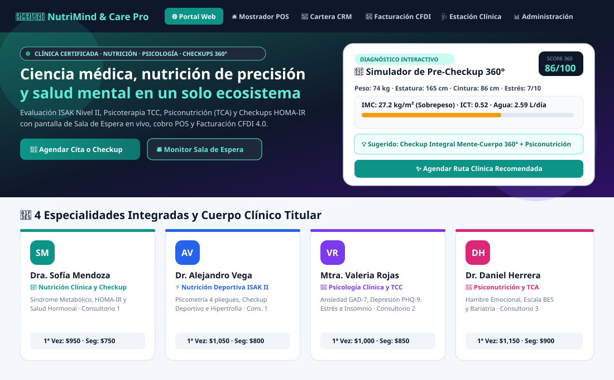
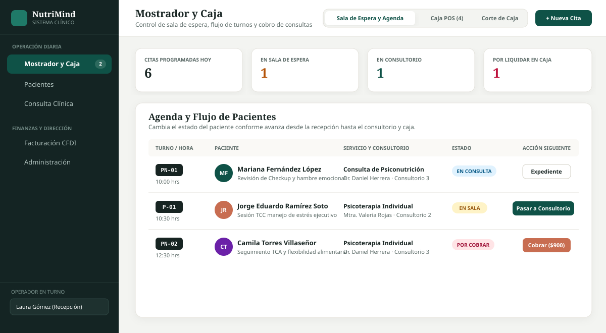
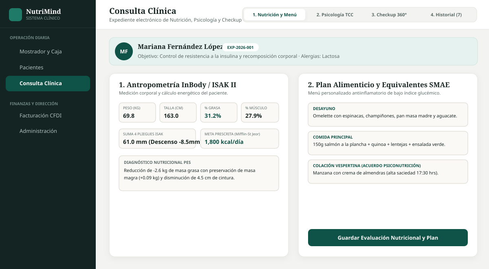
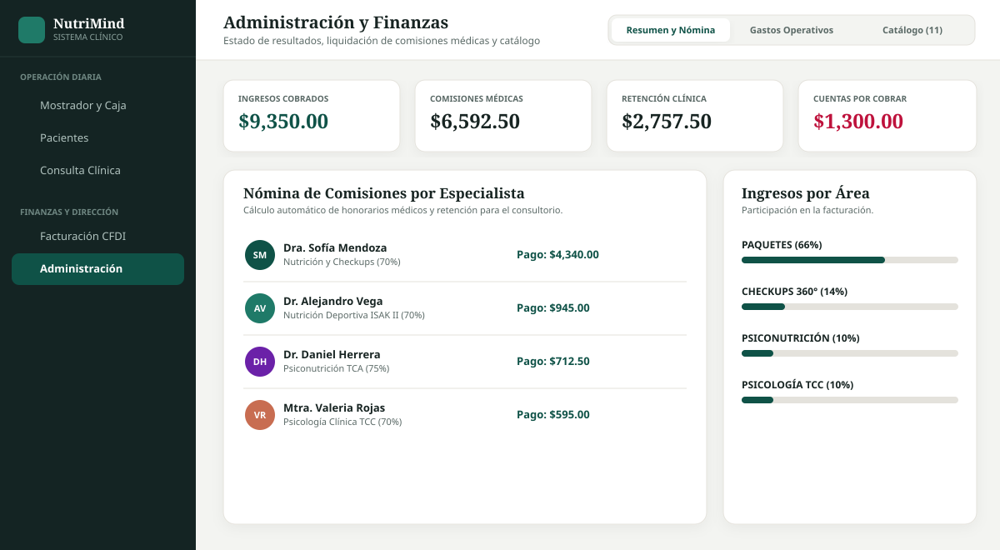
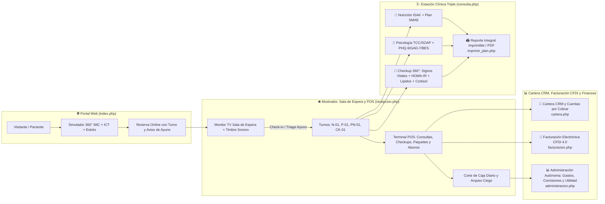
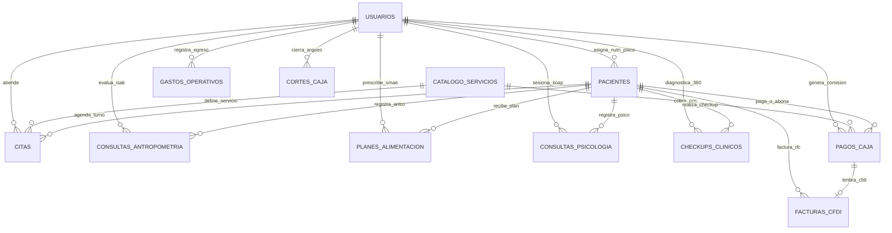

# 🧠🥗🔬 NutriMind & Care Pro — Plataforma Integral de Nutrición, Psicología, Psiconutrición y Checkups 360° (PHP 8 + MySQL/SQLite para cPanel)

**NutriMind & Care Pro** es una plataforma clínica, recepcional, fiscal y financiera de **administración autónoma**, diseñada para operar de punta a punta un centro interdisciplinario de **Nutrición Clínica y Deportiva (ISAK II)**, **Psicología Clínica (TCC)**, **Psiconutrición (TCA y Hambre Emocional)** y **Checkups Médicos Preventivos 360°**.

Construida en **PHP 8 (PDO) + MySQL/MariaDB (con soporte automático SQLite local) + CSS3 Glassmorphism + JS**, está optimizada tanto para ejecutarse localmente al instante (sin configurar servidor externo) como para desplegarse en cualquier servidor compartido con **cPanel** (`public_html`, `MySQL® Database Wizard`, `phpMyAdmin` y despliegue continuo con `Git™ Version Control`).

---

## 📸 Vista Previa del Diseño UX/UI e Interfaz por Módulo

### 1. 🌐 Portal Web con Simulador Interactivo de Pre-Checkup 360° (`index.php`)
Presenta las **4 áreas clínicas integradas**, el directorio de los **4 especialistas titulares**, el catálogo interactivo con filtros en vivo (`Checkups 360°`, `Paquetes y Membresías`, `Psiconutrición`, `Nutrición`, `Psicología`), un **Simulador Biométrico y Psicoemocional 360°** con controles deslizantes (*range sliders*) y el sistema de reserva en línea que asigna turno automático para Sala de Espera (`N-`, `P-`, `PN-`, `CK-`).



### 2. 🛎️ Mostrador, Monitor TV de Sala de Espera con Timbre Sonoro y Caja POS (`recepcion.php`)
Permite operar la clínica desde el mostrador: pantalla en vivo de Sala de Espera con reloj digital, verificación de **ayuno de 8-10h para Checkups**, botón **🔔 Llamar Turno** con timbre clínico (*Web Audio API*), terminal **Punto de Venta (POS)** con desglose en vivo de comisiones médicas, redención de sesiones de paquete, abonos a cuentas por cobrar y **Corte de Caja Diario / Arqueo Ciego**.



### 3. 🩺 Estación Clínica Triple: Nutrición ISAK + Psicología TCC/SOAP + Checkups 360° (`consulta.php`)
Estación de trabajo interdisciplinaria con expediente clínico compartido y 3 pestañas especializadas:
1. **🥗 Nutrición, Antropometría ISAK (4 pliegues) y Plan SMAE**
2. **🧠 Psicología Clínica y Psiconutrición (Notas SOAP + Escalas PHQ-9, GAD-7 y BES)**
3. **🔬 Checkup Médico Integral 360° (Signos Vitales + Glucosa + Insulina + Cálculo automático de HOMA-IR + Lípidos + Tiroides + Cortisol)**



### 4. 📊 Cartera de Clientes CRM, Facturación CFDI 4.0 y Administración Autónoma (`cartera.php`, `facturacion.php`, `administracion.php`)
Gestión integral de **membresías y paquetes prepagados**, seguimiento de **cuentas por cobrar** con recordatorios por WhatsApp en 1 clic, **Facturación Electrónica CFDI 4.0** con catálogos oficiales del SAT (`Uso D01`, claves `85121800` y `85121600`), liquidación automática de **comisiones por especialista** y control de **gastos operativos y laboratorio subrogado**.



---

## 🏗️ Arquitectura Operativa de Punta a Punta



---

## 🧮 Fórmulas Clínicas, Escalas Psicométricas, Biomarcadores y Reglas Fiscales

| Especialidad / Área | Algoritmo / Escala / Norma Implementada | Aplicación en el Sistema |
| :--- | :--- | :--- |
| **Gasto Energético (TMB y GET)** | **Mifflin-St Jeor**, **Katch-McArdle** (`370 + 21.6 × Masa Magra kg`) y **Harris-Benedict** + Factor Actividad Física (`1.2` a `1.9`) + `10% ETA` | Prescripción calórica personalizada y distribución de equivalentes **SMAE** en `consulta.php`. |
| **Antropometría ISAK (4 Pliegues)** | Suma de pliegues **Tricipital, Bicipital, Subescapular y Suprailíaco** (mm) + **IMC**, **ICC** e **ICT** (`Cintura / Talla`, alerta si `≥ 0.50`) | Monitoreo objetivo de adiposidad subcutánea, masa muscular y riesgo cardiometabólico. |
| **Checkup 360° e Índice HOMA-IR** | `HOMA-IR = (Glucosa Ayuno mg/dL × Insulina Basal μUI/mL) / 405` + Panel Lipídico, HbA1c, TSH, Cortisol, Vitamina D y Signos Vitales | Detección temprana de resistencia a la insulina (`< 2.0` óptimo, `2.0 - 2.9` precaución, `≥ 2.9` resistencia significativa) y Score 360°. |
| **Tamizaje Psicológico y TCA** | **PHQ-9** (Depresión `0-27`), **GAD-7** (Ansiedad `0-21`), **BES** (*Binge Eating Scale* / Atracón `0-46`) + Formato Clínico **SOAP** | Evaluación cuantitativa de evolución emocional, ansiedad alimentaria y trastornos de la conducta alimentaria. |
| **Comisiones y Corte de Caja** | `Comisión = Monto Cobrado × % Especialista (70% - 75%)` · `Arqueo = Fondo Fijo + Efectivo Cobrado - Gastos Caja Chica` | Liquidación transparente de honorarios médicos y control de efectivo en gaveta. |
| **Facturación CFDI 4.0 (SAT)** | Claves SAT `85121800` (Nutrición/Checkup) y `85121600` (Psicología), Unidad `E48`, Uso `D01` (Deducción personal médica), Exento de IVA (Art. 15 LIVA) | Timbrado de recibos POS con generación de Folio Fiscal UUID y representación impresa PDF en `facturacion.php`. |

---

## 🗄️ Modelo Entidad-Relación de la Base de Datos (`database.sql` — 12 Tablas)



---

## 📂 Estructura Completa de Archivos

| Archivo | Rol en la Plataforma |
| :--- | :--- |
| [`database.sql`](database.sql) | Esquema MySQL 8 / MariaDB InnoDB con **12 tablas** y datos semilla completos para demostración inmediata |
| [`db_connection.php`](db_connection.php) | Núcleo de conexión dual (**MySQL para cPanel + Auto-SQLite Local**), seguridad CSRF, fórmulas clínicas y catálogos SAT |
| [`index.php`](index.php) | Landing page moderna con orbes animados, **Simulador 360° interactivo**, filtros de catálogo en vivo y reserva online |
| [`recepcion.php`](recepcion.php) | Mostrador, monitor TV de Sala de Espera con **timbre sonoro**, triage de Checkups, terminal **POS** y Corte de Caja diario |
| [`cartera.php`](cartera.php) | Cartera de Clientes CRM, control de paquetes/checkups prepagados, cuentas por cobrar, abonos y ficha fiscal CFDI |
| [`facturacion.php`](facturacion.php) | Centro de Facturación Electrónica **CFDI 4.0**, timbrado de recibos pendientes y representación impresa PDF |
| [`consulta.php`](consulta.php) | Estación clínica interdisciplinaria con 3 pestañas: **Nutrición ISAK + SMAE**, **Psicología TCC/SOAP** y **Checkups 360° (HOMA-IR)** |
| [`administracion.php`](administracion.php) | Administración autónoma: Estado de resultados, liquidación de comisiones por especialista, gastos operativos y catálogo |
| [`imprimir_plan.php`](imprimir_plan.php) | Reporte clínico integral imprimible/PDF (Resultados Checkup 360° + Antropometría ISAK + Menú SMAE + Acuerdos TCC) |
| [`style.css`](style.css) | Sistema de diseño clínico moderno (*Glassmorphism*, tipografía `Plus Jakarta Sans` + `Inter`, animaciones y `@media print`) |
| [`.cpanel.yml`](.cpanel.yml) | Configuración de despliegue automático hacia `public_html/` mediante **Git™ Version Control** en cPanel |

---

## 🚀 Guía de Ejecución Local y Despliegue en cPanel

### Opción A: Ejecución Local Instantánea (Sin instalar MySQL)
Gracias al motor dual en [`db_connection.php`](db_connection.php), si ejecutas el proyecto en tu computadora sin un servidor MySQL activo, el sistema **crea e inicializa automáticamente** una base de datos local SQLite (`nutrimind_local.sqlite`) con las 12 tablas y todos los pacientes, citas, checkups, pagos y facturas de demostración:
```bash
php -S localhost:8000
```
Luego abre `http://localhost:8000` en tu navegador. Puedes cambiar de operador en turno (Mostrador, Nutriólogo, Psicólogo o Administrador) desde el selector en la esquina superior derecha de la barra de navegación.

### Opción B: Despliegue en Servidor de Producción con cPanel
1. **Base de Datos MySQL**:
   - En tu **cPanel**, abre **MySQL® Database Wizard** y crea la base de datos y el usuario con todos los privilegios.
   - Entra a **phpMyAdmin**, selecciona tu base de datos e importa el archivo [`database.sql`](database.sql).
   - Configura tus credenciales (`DB_NAME`, `DB_USER`, `DB_PASS`) en [`db_connection.php`](db_connection.php).
2. **Despliegue Automático con Git™ Version Control**:
   - En cPanel, abre **Git™ Version Control**, clona `https://github.com/Skullnietz/nutricare-pro-cpanel.git` y en la pestaña **Pull or Deploy** presiona **Deploy HEAD Commit**. El archivo [`.cpanel.yml`](.cpanel.yml) copiará automáticamente todos los módulos PHP, hojas de estilo y recursos gráficos hacia `public_html/`.
